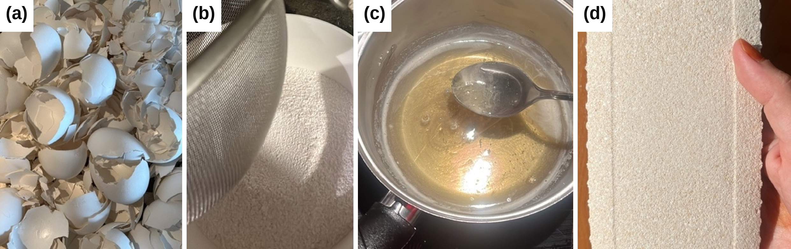
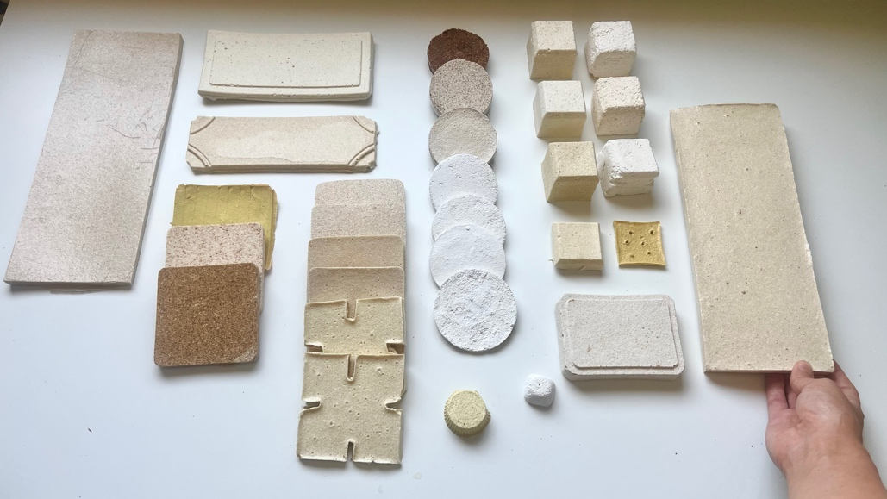
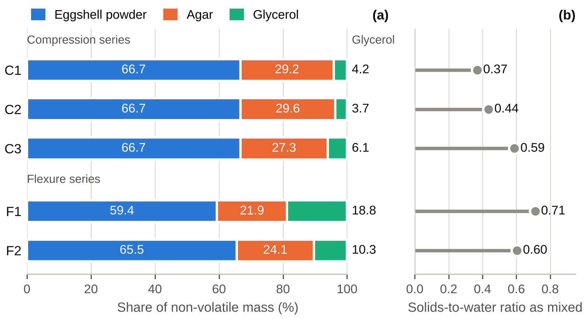
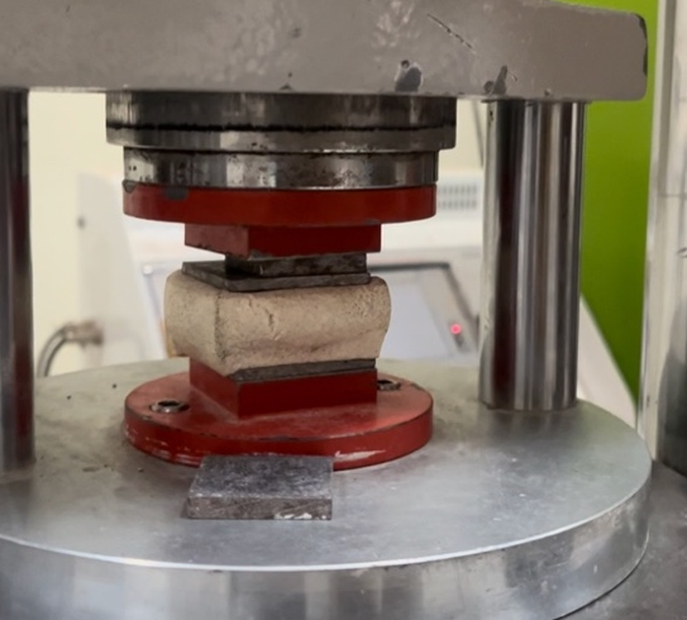
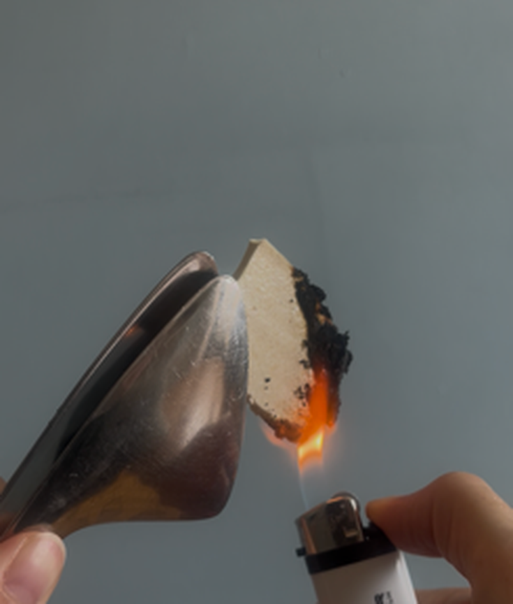

::: {custom-style="Title"}
From Strength to Resilience: Production, Characterisation and Evaluation of a Fully Bio-Based Eggshell–Agar Composite for Interior Surfaces
:::

::: {custom-style="Author"}
Betül Ünal
:::

::: {custom-style="Affiliation"}
Department of Interior Architecture, Cappadocia University, Nevşehir, Türkiye

[Corresponding author e-mail · ORCID iD — to be added]{custom-style="Placeholder"}
:::

## Abstract {.unnumbered}

Eggshell is discarded in millions of tonnes a year and is widely studied as a source of calcium carbonate, almost always as a minor filler in a cementitious, ceramic or polymer matrix. This study reports a composite in which eggshell powder is the major phase, two-thirds of the dry mass, bound by agar and glycerol, cast from water below 100 °C and dried at ambient temperature. The production protocol is documented, and five formulations are characterised in compression, three-point bending, small-flame exposure and water immersion. Mean compressive strength rose from 2.55 to 4.10 MPa as the solids-to-water ratio of the mixture rose from 0.37 to 0.59 at a constant mineral fraction (R^2^ = 0.994, three means). Halving the glycerol content turned a material too compliant to test into one with a nominal flexural strength of 2.33 MPa and a modulus of 192 MPa. Specimens self-extinguished about 4 s after a small flame was removed; a shellac-coated specimen gained 0.7% in mass in 24 h of immersion. Against sources that report strength and modulus together, the composite exceeds heat-pressed mycelium composites in strength, stiffness and stored elastic energy (14.1 kJ/m^3^), falls below the minimum requirements for particleboard and MDF on all three, and exceeds them in elastic strain capacity (1.2%). In both mechanical tests it deformed extensively without fragmenting. Strength alone is therefore an inadequate criterion for such materials: strength, modulus and failure mode should be reported together. The dataset rests on means without dispersion and on nominal dimensions; its limits are stated in full.

**Keywords:** eggshell waste; agar; bio-based composite; production protocol; modulus of resilience; non-loadbearing interior surfaces

# 1. Introduction

## 1.1 Eggshell as a secondary mineral resource

Hen eggshell is generated continuously by food processing, catering and households, and most of it is discarded. With the shell accounting for about 11% of the mass of an egg, the quantity arising worldwide has been estimated at 7.8 million tonnes a year (Skórczewska et al., 2022); another estimate puts the quantity sent to landfill at 6.4 million tonnes (Ngayakamo & Onwualu, 2022). In Europe up to 150 000 tonnes are generated annually, and landfilling is usually the only outlet (Vilarinho et al., 2022).

What is discarded is a comparatively pure mineral. The shell consists of about 94% calcium carbonate in the form of calcite, about 1% each of magnesium carbonate and calcium phosphate, and about 4% organic matter (Ngayakamo & Onwualu, 2022; Skórczewska et al., 2022); a calcium carbonate content of 88 wt.% has been measured on ground shell (Owuamanam et al., 2021). Attached to the shell is the shell membrane, a network of biopolymer fibres (Torres et al., 2010). The specific gravity of eggshell powder is reported as 2.07–2.50 (Ngayakamo & Onwualu, 2022).

These properties have made eggshell one of the more closely examined secondary sources of calcium carbonate. Table 1 groups representative studies by the phase that binds the shell. In cementitious systems eggshell powder replaces part of the cement, usually together with fly ash (Teara et al., 2019; Teara & Doh, 2020), and the field has been reviewed by Nandhini and Karthikeyan (2022); Ngayakamo and Onwualu (2022) conclude that additions of 5–30% yield construction materials within the range of established standards. Eggshell has also been used as a partial substitute for lime in soil stabilisation (Diana et al., 2021), as a mineral filler in hot-mix asphalt (Masued, 2019), as a replacement for limestone in ceramic wall tiles (Vilarinho et al., 2022) and as an addition to fired clay bricks (Ngayakamo et al., 2020). In polymers it has been compounded into poly(vinyl chloride) (Skórczewska et al., 2022), flexible polyurethane foam (Victor et al., 2019), polylactic acid (Cree et al., 2023) and a partially bio-derived epoxy (Owuamanam et al., 2021); the polymer literature as a whole has been reviewed by Owuamanam and Cree (2020). Further uses range from sintered ceramic–metal composites (Bilici et al., 2023; Yönetken et al., 2022) to calcium phosphate for bone scaffolds (Shafiei et al., 2019).

Table: **Table 1.** Reported uses of eggshell, grouped by the phase that binds it.

| Application | Binding phase | Role of eggshell as reported | Source |
|:------------------|:-------------------|:----------------------------|:--------------------|
| Concrete | Portland cement | Partial cement replacement with fly ash (35–45% combined; 5–10% eggshell in high-strength mixes) | Teara et al. (2019); Teara & Doh (2020) |
| Fired clay brick | Clay body fired at 900–1100 °C | 10% eggshell powder with 20% granite powder | Ngayakamo et al. (2020) |
| Soil stabilisation | Hydrated lime or quicklime | Substitute for up to 50% of the optimum lime content | Diana et al. (2021) |
| Hot-mix asphalt | Bitumen | Mineral filler in place of Portland cement; optimum 6% | Masued (2019) |
| Ceramic wall tile | Fired ceramic body | Replaces limestone, up to 100% | Vilarinho et al. (2022) |
| Poly(vinyl chloride) | Unplasticised PVC, extruded | Filler, 10–40 phr | Skórczewska et al. (2022) |
| Polyurethane foam | Flexible polyurethane | 5–20% of the calcium carbonate filler | Victor et al. (2019) |
| Polylactic acid | PLA | Filler, 5–20 wt.% | Cree et al. (2023) |
| Bio-epoxy | Partially bio-derived epoxy | Filler, 5–20 wt.% | Owuamanam et al. (2021) |
| Starch film | Corn starch, cast film | Additive in the film | Vonnie et al. (2022) |
| Ceramic–metal composite | Fe–B~4~C sintered at 1400 °C | Reinforcement, up to 6.66% | Bilici et al. (2023); Yönetken et al. (2022) |
| This study | Agar–glycerol gel, cast below 100 °C | Major phase, 59–67% of the dry mass | — |

Three features recur in Table 1. First, eggshell replaces part of an existing mineral ingredient—cement, lime, limestone or a mineral filler—or is added to a polymer at a loading of 5 to 40 parts; it is the minor phase. Second, the continuous phase is Portland cement, lime, bitumen, a fired or sintered body, or a synthetic polymer. Third, where the matrix is itself bio-based, as with polylactic acid (Cree et al., 2023), a partially bio-derived epoxy (Owuamanam et al., 2021) or corn starch (Vonnie et al., 2022), the product is a filled polymer or a thin film. What has not been reported, to the author's knowledge, is a cast solid in which eggshell is the major phase and the binder is a native polysaccharide gel.

## 1.2 Agar as a binder

Agar is a biopolymer extracted from certain red algae (Mostafavi & Zaeim, 2020). It dissolves in hot water and sets on cooling to a thermoreversible gel (Armisen, 1997), so that a mineral powder can be dispersed in the hot solution and held in place as the solution cools, without a hardener and without a curing reaction.

As a material, agar has been studied almost entirely in the form of thin films for packaging. Plain agar films are brittle and permeable to moisture, and research has concentrated on plasticisers, blends with other biopolymers, hydrophobic components and nanoscale reinforcements such as clay (Mostafavi & Zaeim, 2020; Rhim, 2011). Hernández et al. (2022) mapped the agar–glycerol–water system systematically. Across 32 formulations, tensile strength ranged from 0.11 to 39.11 MPa and elongation at break from 3.9% to 115.8%; stiffness was highest where the water content was low relative to agar, and higher glycerol contents increased ductility at the expense of strength and stiffness. Shellac has been applied to agar films as a moisture-barrier layer (Phan The et al., 2008).

These studies concern unfilled or lightly filled films loaded in tension. Agar has not, to the author's knowledge, been characterised as the binder of a thick, highly mineral-filled cast solid loaded in compression and in bending, which is the loading relevant to a surface component.

## 1.3 Reporting and evaluation of designer-made bio-based materials

A second obstacle is procedural. Material-driven design places the material and its behaviour at the start of the design process (Karana et al., 2015), and a growing body of work comes from designers who produce their own materials, often by techniques of their own devising (Ayala Garcia et al., 2017; Rognoli et al., 2015). Such work depends on being able to make the material repeatably, yet production parameters are often reported incompletely. The same difficulty is recorded for the better-studied mycelium composites: reviews point to gaps in the documentation of material properties (Jones et al., 2020) and to technical details withheld for commercial reasons (Girometta et al., 2019), and Elsacker et al. (2019) present the full disclosure of their protocol as a contribution in its own right.

A third issue is the criterion by which such materials are judged. Studies of eggshell-filled polymers report tensile and flexural strength, modulus and impact energy (Owuamanam & Cree, 2020). A common finding is that the filler raises stiffness (Cree et al., 2023; Owuamanam et al., 2021; Skórczewska et al., 2022), while impact energy falls (Cree et al., 2023; Owuamanam et al., 2021) and strength may not exceed that of the unfilled matrix (Owuamanam et al., 2021). Judged by strength, a soft bio-based composite will always appear as a weak version of whatever it is compared with. Strength, however, records the stress at which a material ceases to carry load. It says nothing of how much deformation the material accommodates before that point, or of what happens after it.

Two established concepts address those questions. In materials science, the modulus of resilience is the strain energy per unit volume that a material absorbs elastically, *U*~r~ = *σ*~y~^2^/2*E* (Callister & Rethwisch, 2018), and the ratio *σ*~f~^2^/*E* is the index by which materials are ranked for the storage of elastic energy (Ashby, 2011). In systems ecology, resilience denotes the capacity of a system to absorb disturbance and persist, as distinct from stability, the capacity to return to equilibrium (Holling, 1973). Holling (1996) later separated engineering resilience, which concerns recovery near an equilibrium, from ecological resilience, which concerns the magnitude of disturbance that can be absorbed before a system changes its structure. The dissertation from which this article derives (Ünal, 2025) is concerned with spatial resilience, a concept of the second kind. The present article is its materials component, and asks whether the first, which can be measured, can serve as a criterion for evaluating the material.

## 1.4 Aim, research questions and hypothesis

Three gaps follow from the preceding sections. In reported eggshell composites the shell is a minor phase in a mineral, ceramic or polymer matrix; a cast solid with eggshell as the major phase and a native polysaccharide as the binder has not been characterised. Agar has been characterised as a film in tension, not as the binder of a mineral-filled solid in compression and bending. And the production parameters and properties of designer-made bio-based materials are reported in fragments, with an evaluation that rests on strength.

The aim of the study is to document a reproducible production protocol for a fully bio-based eggshell–agar composite and to characterise it with reference to published test standards. Four objectives follow: (i) to document the protocol with every parameter that was controlled or recorded; (ii) to characterise compressive, flexural, small-flame and water-absorption behaviour, stating every departure from the standards referred to; (iii) to position the results against conventional interior boards and against other bio-based composites, using only published data whose source could be checked; and (iv) to derive an evaluation criterion suited to this class of material.

The research questions are the following.

- RQ1. Which formulation variable governs compressive strength?
- RQ2. How does plasticiser content affect flexural behaviour?
- RQ3. How does the composite compare with conventional interior board materials?
- RQ4. How does it compare with other bio-based composites?
- RQ5. Is strength an adequate evaluation criterion for this class of material?

The first four questions are answered by measurement and comparison, the fifth by argument from them. The working hypothesis is that a fully bio-based eggshell–agar composite can be produced repeatably under ambient conditions, and that its performance as an interior surface material is governed by deformation capacity rather than by compressive strength. The material is considered throughout as a non-loadbearing interior surface; no structural use is proposed.

# 2. Materials and Methods

## 2.1 Research design

The study followed a material-driven sequence (Karana et al., 2015) in four stages. The material was produced with its parameters recorded; it was tested; the results were positioned against two families of materials; and an evaluation criterion was derived from the behaviour observed. The application envelope in Section 4.4 was derived from the results and was not set in advance.

## 2.2 Constituents

Four constituents were used. Eggshell powder forms the mineral phase, agar the continuous binding phase, and glycerol the plasticiser; water is the processing medium and leaves the material on drying. The composite is called fully bio-based in the sense that mineral phase, binder and plasticiser can all be obtained from biological sources. The shells were collected over more than a year from a single patisserie in Ankara, Türkiye, which also showed that one local source can sustain production at this scale. Agar was used as a powder. Shellac, a natural resin, was applied as a surface finish to the specimen prepared for water absorption only. Gelatine, starch and vinegar were tried as auxiliary constituents during development and are not part of the formulations reported here.

## 2.3 Production protocol

The protocol is summarised in Table 2 and illustrated in Figure 1.

### 2.3.1 Mineral fraction

The shells were freed of adhering membrane and organic residue and heated in a laboratory oven at 120 °C for 20 min. This step is described as decontamination and drying, not as sterilisation: dry-heat sterilisation requires higher temperatures or longer times, and sterility was not checked. After cooling, the shells were left to dry until no further loss of mass was observed, ground in a laboratory mechanical grinder until the powder appeared uniformly fine, and passed through a 150 µm sieve. Only the passing fraction was used (Figure 1a, b). The upper size limit is of the same order as in the polymer-composite literature, where eggshell fillers of 32 µm (Cree et al., 2023) and of less than 125 µm (Skórczewska et al., 2022) have been used. The particle-size distribution below the sieve limit was not measured.

### 2.3.2 Binder phase

Water and glycerol were first mixed to a uniform liquid. Agar powder was then added a little at a time under continuous stirring, because agar added in bulk forms lumps that do not redisperse. The mixture was heated to 95 °C and held there until the agar had dissolved completely. The temperature was then lowered to 80 °C and cooking continued, with stirring, while the viscosity rose (Figure 1c). Heating lasted 55 min in total across the two stages. Dissolution was completed at the higher temperature before the viscosity was allowed to build, because a mixture that thickens around undissolved agar sets to an uneven gel. Stirring was by hand throughout and the vessel was open: shear rate and mixing energy were not controlled, and the water lost by evaporation during the cook was not measured.

### 2.3.3 Compositing, casting and drying

Towards the end of the cook, with the binder at 80 °C, the sieved powder was added in increments under continuous stirring; added earlier, the mineral settles. Heating was stopped when the mixture was uniform, viscous and still pourable. It was poured into silicone moulds and levelled. Silicone was chosen because it allows the partly set piece to be released without a parting agent and without damage. The geometry of the mould followed the test: 50 mm cubes for compression, flat moulds for the flexure, flame and absorption specimens.

The pieces were left in the moulds for four days, then demoulded and kept for a further seven days at about 23 °C, out of direct sunlight and draughts (Figure 1d). No oven or other forced drying was used after the cook, so that eleven days passed between casting and a finished specimen. The pieces shrink appreciably as the water leaves. Figure 2 shows the range of pieces produced during development.

Table: **Table 2.** Production protocol: parameters that were set, and quantities that were not controlled or not recorded.

| Stage | Operation | Parameters | Not controlled or not recorded |
|:------------|:--------------|:------------------------------|:---------------------|
| Mineral fraction | Cleaning | Removal of membrane and organic residue | — |
| | Heat treatment | 120 °C, 20 min, laboratory oven | Sterility |
| | Drying | Ambient, to constant mass | — |
| | Milling | Laboratory mechanical grinder, to a visually uniform powder | Grinder type, duration |
| | Sieving | 150 µm mesh; passing fraction used | Particle-size distribution |
| Binder phase | Liquid phase | Water and glycerol mixed before any solid is added | — |
| | Agar addition | Incremental, under continuous manual stirring | Shear rate |
| | Dissolution | 95 °C, until fully dissolved | — |
| | Cook | 80 °C, continuous stirring; 55 min heating in total | Evaporation loss |
| Composite | Mineral addition | Near the end of the cook, at 80 °C, incremental | — |
| | Casting | Silicone moulds, levelled, no release agent | Pouring temperature |
| | Drying in the mould | 4 days at about 23 °C, no direct sun or draught | Relative humidity |
| | Consolidation | 7 further days demoulded, same conditions | Dried dimensions and mass |
| Finish | Shellac | Three coats, absorption specimen only | Interval between coats |

{width=16cm}

{width=12.5cm}

## 2.4 Formulations

Five formulations were prepared, three for compression (C1–C3) and two for flexure (F1, F2). Table 3 gives the batch masses and the proportions derived from them, and Figure 3 shows the composition of the dried solid. Two derived quantities are used below. The solids-to-water ratio, S/W, is the mass of the non-volatile constituents (eggshell, agar and glycerol) divided by the mass of water in the batch. It describes the mixture as weighed out and not as cast, since evaporation during the cook was not measured. The dry-basis shares are the masses of the three non-volatile constituents as percentages of their sum, and describe the composition of the solid that remains after drying.

Table: **Table 3.** Formulations: batch masses and derived proportions. C1–C3 form the compression series and F1–F2 the flexure series. S/W is the solids-to-water ratio of the mixture as weighed out; dry-basis shares refer to the non-volatile mass.

| ID | Water (g) | Eggshell (g) | Agar (g) | Glycerol (g) | S/W | Water (% of batch) | Eggshell (% dry) | Agar (% dry) | Glycerol (% dry) | Glycerol : agar |
|:--|-----:|-----:|-----:|-----:|-----:|-----:|-----:|-----:|-----:|-----:|
| C1 | 325 | 80 | 35 | 5 | 0.369 | 73.0 | 66.7 | 29.2 | 4.2 | 0.14 |
| C2 | 310 | 90 | 40 | 5 | 0.435 | 69.7 | 66.7 | 29.6 | 3.7 | 0.13 |
| C3 | 280 | 110 | 45 | 10 | 0.589 | 62.9 | 66.7 | 27.3 | 6.1 | 0.22 |
| F1 | 450 | 190 | 70 | 60 | 0.711 | 58.4 | 59.4 | 21.9 | 18.8 | 0.86 |
| F2 | 480 | 190 | 70 | 30 | 0.604 | 62.3 | 65.5 | 24.1 | 10.3 | 0.43 |

The formulations were arrived at empirically during development, and no factorial design was intended. Their recalculated proportions nevertheless have a clear structure. In the compression series the batch mass is constant at 445 g, and so is the mineral share of the dry mass: in all three formulations the mass of eggshell is exactly twice the combined mass of agar and glycerol, 66.7% of the solid. What changes monotonically is the water content, from 73.0% of the batch in C1 to 62.9% in C3 (S/W from 0.37 to 0.59). The shares of agar and glycerol change by a few points, and not monotonically.

In the flexure series the masses of eggshell and agar are identical in F1 and F2. Glycerol is halved, from 60 g to 30 g, and water is raised by 30 g to keep the batch at 770 g. On a dry basis the only difference between F1 and F2 is therefore the glycerol content, 18.8% against 10.3% of the solid, or 0.86 against 0.43 parts of glycerol per part of agar. The binder solutions are concentrated: agar amounts to between 9.6% and 13.4% of the liquid phase, beyond the range of 0.5–8% covered by the film-forming mixtures of Hernández et al. (2022), who report that higher agar contents gave a thick, rubber-like material unsuited to tensile testing.

{width=16cm}

## 2.5 Test methods

The mechanical tests were carried out at the Advanced Construction Materials Research Laboratory of Hacettepe University. Three specimens were tested per formulation in compression and in flexure. The values reported are means of the three; individual values were not retained, and standard deviations cannot be given. The flame, absorption and mass determinations are single observations. Each test refers to a published standard for its principle, but none was carried out in full accordance with it. The departures are listed in Table 4 and taken up again in Section 4.4.

Table: **Table 4.** Test programme and departures from the standards referred to.

| Test | Reference | Specimens | Quantities reported | Departures and limits |
|:-----------|:--------------|:------------------|:-----------------|:------------------------|
| Compression | None | Cubes cast in 50 mm moulds; three per formulation (C1–C3) | Maximum load; stress on the measured dried section | No named standard; dried dimensions not logged; strain not instrumented |
| Three-point bending | ASTM D790-17: configuration and Eq. (1) | Cast in 180 × 60 × 20 mm moulds; span 120 mm; three per formulation (F1, F2) | Maximum load; nominal flexural strength; flexural modulus | Span-to-depth ratio 6:1 instead of 16:1; kerfed tension face; mould dimensions used in Eq. (1) |
| Small-flame exposure | ISO 11925-2:2020: edge exposure, 45°, 15 s | 40 × 50 mm; two exposures | Time to ignition; time to self-extinction; spread; melting and dripping | Hand-held gas lighter; specimen 40 × 50 mm instead of 250 × 90 mm; no test enclosure |
| Water absorption | ASTM D570-98(2018): 24 h immersion | 40 × 50 mm, 10 g, three coats of shellac; one specimen | Mass gain | Non-standard specimen; coated specimen only |
| Mass | — | One C3 cube | Mass | Moisture state, dried volume and batch size not recorded |

### 2.5.1 Compression

Cubes cast in 50 mm moulds were loaded between flat platens to maximum load. Because the cubes shrink on drying, the loaded cross-section was measured on each dried cube at the time of testing and entered into the testing machine, which reported the stress at maximum load. Those dimensions were not logged. The test follows no named standard, and strain was not instrumented.

### 2.5.2 Flexure

Three-point bending used the configuration and the stress formula of ASTM D790-17 (ASTM International, 2017). Specimens were cast in moulds of 180 × 60 × 20 mm and tested on a span of 120 mm. Flexural strength was calculated as

$$\sigma_f = \frac{3FL}{2bd^{2}} \qquad \text{(1)}$$

where *F* is the maximum load, *L* the span, *b* the width and *d* the depth, the last two taken as the mould dimensions (*b* = 60 mm, *d* = 20 mm). Midspan deflection was measured by a displacement transducer bearing on the lower face of the specimen (Figure 6a), and the flexural modulus *E*~f~ was reported by the machine from the initial linear part of the load–deflection record.

Three features of the test depart from the standard. The span-to-depth ratio was 6:1 where the standard specifies 16:1, so that shear contributes to the measured deflection. The specimens carry regularly spaced transverse kerfs on the face placed in tension (Figure 6), whereas Eq. (1) assumes a solid rectangular section. And the dimensions in Eq. (1) are those of the mould, not of the dried specimen. The values of *σ*~f~ and *E*~f~ are therefore nominal. They characterise the kerfed panel as a component and are not constants of the bulk material.

### 2.5.3 Small-flame exposure

The response to a small flame was observed under exposure conditions taken from the single-flame source test of ISO 11925-2 (International Organization for Standardization [ISO], 2020): a flame applied to the edge of the specimen at 45° for 15 s. Dried specimens of 40 × 50 mm were held in metal tongs and exposed to the flame of a hand-held gas lighter (Figure 7), once at an upper and once at a lower corner. Time to ignition, time to self-extinction after removal of the flame, flame spread, melting and dripping were noted. The standard requires specimens of 250 × 90 mm, a specified burner and a test enclosure. The observation is therefore indicative and supports no classification.

### 2.5.4 Water absorption and mass

Water absorption was determined by the 24 h immersion procedure of ASTM D570-98(2018) (ASTM International, 2018) on a single specimen of 40 × 50 mm with an initial mass of 10 g, finished with three coats of shellac. The specimen geometry is not that of the standard, and no uncoated specimen was tested, so the result describes the coated surface and not the composite. The mass of one C3 cube was also recorded (Section 3.4).

## 2.6 Derived quantities and benchmark data

The relation between mean compressive strength and S/W was examined by least-squares regression on the three formulation means. With three points the fit has one residual degree of freedom, and it is reported as a description of the trend and not as a model.

For the flexural result, two quantities were derived on the idealisation of linear-elastic behaviour up to maximum load. The first is the elastic strain capacity,

$$\varepsilon_{el} = \frac{\sigma_f}{E_f} \qquad \text{(2)}$$

the outer-fibre strain that corresponds to the flexural strength at the measured modulus. The second is the modulus of resilience evaluated at the flexural strength,

$$U = \frac{\sigma_f^{2}}{2E_f} \qquad \text{(3)}$$

which is the elastic strain energy per unit volume at the outer fibre at midspan, and half of the index *σ*~f~^2^/*E* of Ashby (2011). Where a yield point is defined, Eq. (3) with the yield stress is the modulus of resilience of the textbooks (Callister & Rethwisch, 2018). Here the flexural strength takes its place, and *U* is used as an index for comparison, not as a measured property; it is referred to below as the resilience index. For a rectangular beam in three-point bending, the elastic energy density averaged over the span is *U*/9, a geometric factor common to all materials.

Benchmark data were restricted to sources whose content could be checked directly. For flexure, Eqs. (2) and (3) were applied only where strength and modulus are given for the same material: the nine mycelium composites tested in three-point bending by Appels et al. (2019); the minimum requirements for particleboard of type P2 in EN 312 (European Committee for Standardization [CEN], 2010) and for general-purpose MDF in EN 622-5 (CEN, 2009), in the thickness ranges of over 13 to 20 mm and over 12 to 19 mm respectively; and, as a stiff and brittle mineral reference, concrete of strength class C20/25, for which EN 1992-1-1 (CEN, 2004) gives a mean tensile strength of 2.2 MPa, a flexural tensile strength of (1.6 − *h*/1000) times that value for a section of depth *h* in millimetres, and a modulus of 30 GPa. Measured flexural strengths of 12.5 mm gypsum plasterboard were taken from Ranachowski et al. (2020), who report no modulus. For compression, values were taken from Elsacker et al. (2019) for mycelium composites and from Ngayakamo et al. (2020) for fired clay bricks containing eggshell.

The benchmark values come from different specimen sizes and test arrangements and, in the case of the standards, are minimum requirements and not measurements. They position the composite; they do not constitute a controlled comparison. All derived values were computed with a script that is available from the author.

# 3. Results

## 3.1 Compressive behaviour

Table 5 gives the results of the compression series. Mean maximum load rose from 3.89 kN for C1 to 6.80 kN for C3, and mean compressive strength from 2.55 MPa to 4.10 MPa, an increase of 61%.

Table: **Table 5.** Compression series: means of three specimens per formulation. The implied loaded area is the quotient of mean load and mean stress; it is back-calculated, not measured.

| ID | S/W | Maximum load (kN) | Compressive strength *σ*~c~ (MPa) | Implied loaded area (mm^2^) | Load over the mould face (MPa) | *σ*~c~ / (S/W) (MPa) |
|:----|------:|------:|------:|------:|------:|------:|
| C1 | 0.369 | 3.89 | 2.55 | 1525 | 1.56 | 6.91 |
| C2 | 0.435 | 4.30 | 3.12 | 1378 | 1.72 | 7.16 |
| C3 | 0.589 | 6.80 | 4.10 | 1659 | 2.72 | 6.96 |

Dividing the mean load by the mean stress gives the loaded area implied by the output of the machine: about 1525, 1380 and 1660 mm^2^, or 55–66% of the 2500 mm^2^ face of the mould. For a square section this corresponds to an edge of 37–41 mm and to a linear drying shrinkage of roughly 19–26%. These figures are back-calculated from rounded means and are not measurements, and they do not vary systematically with water content. They do confirm that the stresses refer to sections much smaller than the mould. The ranking of the three formulations does not depend on them: referred to the face of the mould, the loads give 1.56, 1.72 and 2.72 MPa.

Strength increased with the solids-to-water ratio of the mixture (Figure 4). The least-squares line through the three means is

$$\sigma_c = 6.93\,(S/W) + 0.04 \qquad \text{(4)}$$

with *σ*~c~ in MPa, R^2^ = 0.994 and *p* = 0.047 on one residual degree of freedom. The intercept is negligible, so that strength is in effect proportional to S/W: the quotient *σ*~c~/(S/W) lies between 6.9 and 7.2 MPa for all three formulations, and a line through the origin with a slope of 7.0 MPa reproduces each mean to within 2.2%. A straight line in the water mass fraction of the batch fits equally well (R^2^ = 0.999); three points cannot distinguish between the two descriptions. The dry-basis shares of agar and glycerol show no comparable relation (R^2^ = 0.72 in both cases, *p* = 0.36), and the eggshell share is constant.

{width=10.5cm}

No instrumented stress–strain record is available. As observed during the tests, the maximum load was not followed by an abrupt drop; the cubes shortened and barrelled while remaining in one piece (Figure 5). The deformation at maximum load was estimated by eye at about 10% of the height. This figure is an observation and is not used in any calculation below.

{width=8.5cm}

## 3.2 Flexural behaviour

The two flexural formulations behaved in different ways. F1, with 60 g of glycerol (18.8% of the dry mass), deflected under the loading nose without developing a measurable resistance; the specimens could be bent by hand, and no strength value was obtained. F2, with 30 g of glycerol (10.3%), carried a mean maximum load of 310 N. With *L* = 120 mm, *b* = 60 mm and *d* = 20 mm, Eq. (1) gives a nominal flexural strength of 2.33 MPa. The machine reported a flexural modulus of 192 MPa.

Figure 6 shows the test arrangement and the deformation of the kerfed specimens. At large deflection the kerfs open on the tension face and the specimen folds without separating into two parts (Figure 6b). A kerfed panel can be bent by hand into an arch (Figure 6c).

{width=16cm}

## 3.3 Response to a small flame

Under the flame the specimen ignited after about 10 s. When the flame was removed, burning ceased within 4 s. Charring was confined to the area of flame contact (Figure 7), and the flame did not spread across the surface in either exposure. Smoke and a characteristic smell were noted. The material did not melt or drip, and it kept its shape outside the charred zone.

{width=6cm}

## 3.4 Water absorption and mass

The shellac-coated specimen gained about 0.7% in mass in 24 h of immersion, that is, about 0.07 g on 10 g. A slight swelling was noted. The specimen remained intact, but at points where the coating was thin or incomplete the surface softened and material was lost locally.

A mass of 173 g was recorded for one C3 cube. Referred to the 125 cm^3^ volume of the mould this would correspond to 1.38 g/cm^3^, but the figure is not used, because it cannot be reconciled with the recipe: the non-volatile constituents of the whole C3 batch in Table 3 weigh 165 g, so that a dried cube cast from that batch cannot weigh more. Either the cube was weighed before it had dried, or the recipe masses refer to a different batch size than the one from which the cube was cast. The mass is therefore reported as an unresolved record, not as a density, and no density is claimed for the dried material.

## 3.5 Derived flexural quantities

For F2, Eq. (2) gives an elastic strain capacity of 1.21%, equivalent on the linear idealisation to a midspan deflection of 1.45 mm on the 120 mm span. Eq. (3) gives a resilience index of 14.1 kJ/m^3^ at the outer fibre, or 1.6 kJ/m^3^ averaged over the span, which amounts to about 0.23 J of elastic energy in the specimen at maximum load. Both quantities inherit the nominal character of *σ*~f~ and *E*~f~.

# 4. Discussion

The discussion follows the order in which the evidence builds. Section 4.1 identifies what governs the mechanical behaviour of the composite (RQ1 and RQ2). Section 4.2 places the result among interior boards and other bio-based composites (RQ3 and RQ4). Section 4.3 considers what that placement implies for the way such materials are evaluated (RQ5). Section 4.4 sets out the conditions under which the material could be used and how far the evidence behind them extends.

## 4.1 Formulation and mechanical behaviour

Within the range examined, compressive strength followed the water content of the mixture and not its mineral content (RQ1). This reading does not rest on the regression. With three points that lie almost on a line, a fit would be as good against any quantity that changes steadily from C1 to C3, the batch mass of eggshell included: in this series the mass of eggshell is an exact linear function of the mass of water, and the two cannot be separated statistically. The reading rests on the composition of the dried solid. Water leaves the material, and what remains in C1, C2 and C3 is two parts of eggshell to one part of binder in every case. The cubes do not differ in how much mineral the solid contains. They differ in the amount of water that had to leave it and, to a small degree, in the division of the binder between agar and glycerol. That division cannot account for the trend. C3 has the highest glycerol-to-agar ratio of the three, 0.22 against 0.14 and 0.13, and the lowest share of agar, which on the evidence of the flexural series below and of agar films (Hernández et al., 2022) should soften the material; yet C3 is the strongest.

The likely mechanism is densification. A mixture with less water has less volume to lose on drying and can be expected to consolidate to a solid with less porosity and fewer shrinkage defects; in agar films, too, stiffness rises as the water content falls relative to agar (Hernández et al., 2022). The proportionality between strength and S/W, with an intercept indistinguishable from zero, is at least consistent with the limiting case that a mixture without solids has no strength. But the porosity, density and shrinkage of the dried cubes were not measured, the water content as cast is unknown, and three formulation means without dispersion cannot establish a law. The answer to RQ1 is therefore a well-supported hypothesis: at a fixed ratio of mineral to binder, compressive strength is governed by the water content of the mixture. Its practical corollary is that the route to higher strength in this system is less water, not more shell, up to the limit, not explored here, at which the mixture can no longer be poured.

The flexural series isolates the plasticiser more cleanly than its design suggests (RQ2). Between F1 and F2 the dried solid differs only in glycerol, and the accompanying change is 30 g more water in the F2 mixture. If the trend of the compression series holds, more water would weaken F2, not strengthen it, so that the confounding variable acts against the effect observed. Halving the glycerol content, from 0.86 to 0.43 parts per part of agar, was thus enough to turn a material that could not be tested into one with measurable strength and stiffness. The direction agrees with the behaviour of agar films, in which glycerol raises ductility and lowers strength and modulus (Hernández et al., 2022). The magnitude of the effect cannot be stated: one of the two levels produced no number, and the transition lies somewhere between them. The compression formulations, at 0.13–0.22 parts of glycerol per part of agar, lie well on the stiff side of it.

Taken together, the two series point to two levers: the water content of the mixture, which sets strength within the stiff range, and the glycerol content, which sets whether the material is stiff or pliable at an unchanged mass of eggshell and agar. That is of direct use to a designer who produces the material by hand. The data indicate the two levers but do not isolate them from each other, and mapping the glycerol transition would require a series in which glycerol is varied in small steps at a constant water content (Section 4.4).

## 4.2 Position among interior boards and bio-based composites

Table 6 and Figure 8 set the flexural result against benchmark data, selected as described in Section 2.6.

Table: **Table 6.** Flexural benchmark. *ε*~el~ and *U* are calculated from Eqs. (2) and (3) wherever strength and modulus are given for the same material; ranges cover the individual materials of each group.

| Material | Basis | *σ*~f~ (MPa) | *E*~f~ (MPa) | *ε*~el~ (%) | *U* (kJ/m^3^) | Source |
|:----------------------|:---------------|-------:|-------:|-------:|-------:|:--------------|
| Concrete C20/25, flexural value extrapolated to a 20 mm section | Design values | 3.5 | 30 000 | 0.012 | 0.20 | CEN (2004) |
| Mycelium composites, non-pressed (four) | Measured means | 0.05–0.29 | 1–9 | 3.2–7.3 | 1.3–8.1 | Appels et al. (2019) |
| Mycelium composites, cold-pressed (two) | Measured means | 0.21–0.24 | 12–15 | 1.4–2.0 | 1.5–2.4 | Appels et al. (2019) |
| Mycelium composites, heat-pressed (three) | Measured means | 0.62–0.87 | 34–80 | 1.1–1.8 | 4.6–5.7 | Appels et al. (2019) |
| **Eggshell–agar composite, F2** | Measured mean, nominal section | **2.33** | **192** | **1.21** | **14.1** | This study |
| Gypsum plasterboard, 12.5 mm, standard type | Measured, two directions | 2.62–4.74 | — | — | — | Ranachowski et al. (2020) |
| Particleboard P2, over 13 to 20 mm | Minimum requirement | 11 | 1600 | 0.69 | 37.8 | CEN (2010) |
| MDF, general purpose, over 12 to 19 mm | Minimum requirement | 20 | 2200 | 0.91 | 90.9 | CEN (2009) |
| PLA with eggshell powder | Measured maxima, at different filler contents | 67 | 3400 | — | — | Cree et al. (2023) |

{width=14.5cm}

The comparison with conventional interior boards (RQ3) is unfavourable on every count but one. The nominal flexural strength of F2 is 21% of the minimum required of P2 particleboard and 12% of that required of general-purpose MDF; its modulus is 12% and 9% of the respective requirements. Since boards in service exceed their minimum requirements, the real gap is wider. The composite cannot replace a wood-based board wherever the board spans, carries shelves or holds fixings. Standard 12.5 mm gypsum plasterboard, the usual interior lining, has a measured flexural strength of 2.6 MPa across and 4.7 MPa along the direction of production (Ranachowski et al., 2020); the composite, at 2.3 MPa, lies just below the weaker direction. The one respect in which it exceeds the wood-based boards is elastic strain capacity, 1.2% against 0.7% and 0.9%.

Against other bio-based composites the position is different (RQ4). In compression, the 2.6–4.1 MPa of the C series compares with 0.35–0.45 MPa reported for mycelium composites on flax tow (Elsacker et al., 2019), an advantage of roughly six- to twelve-fold, and is of the same order as the 3.12 MPa of clay bricks containing eggshell and granite waste fired at 900 °C (Ngayakamo et al., 2020). In flexure, F2 has 2.7 times the strength of the strongest and 2.4 times the modulus of the stiffest of the nine mycelium composites of Appels et al. (2019), including those consolidated by heat pressing, and its resilience index is between 1.7 and 11 times theirs.

The two families are not substitutes for each other. The composite is a mineral-rich solid, two-thirds of its dry mass being calcite, whose specific gravity is 2.07–2.50 (Ngayakamo & Onwualu, 2022); its density was not reliably determined (Section 3.4), but it can be expected to lie well above that of mycelium composites, which is 0.06–0.39 g/cm^3^ (Appels et al., 2019; Elsacker et al., 2019), and these are valued above all as insulation (Jones et al., 2020). At the other end of the range, polylactic acid filled with eggshell powder reaches a flexural strength of 67 MPa and a flexural modulus of 3.4 GPa (Cree et al., 2023), some 29 and 18 times the values of F2; but it is a thermoplastic with a minor mineral filler, a different class of material and of process. Nor is the water absorbed by mycelium composites in 24 h, 24–30% (Elsacker et al., 2019), comparable with the 0.7% measured here, which refers to a coated specimen and to a different test.

What distinguishes the present material within the bio-based family is therefore not a single property. It is the combination of a process that needs a hotplate, a mould and time with mechanical values that lie between those of grown composites and those of filled thermoplastics. The composite is thus weaker and softer than the boards it might sit beside, and stronger and stiffer than the grown bio-based composites with which it shares a family, and that is the position from which the question of evaluation arises.

## 4.3 Strength, resilience and failure mode

The benchmark data allow the question of the evaluation criterion (RQ5) to be put concretely, by ranking the same materials on three quantities (Table 6). By flexural strength, the composite stands above the mycelium composites, below thin-section concrete and plasterboard, and far below the wood-based boards. By elastic strain capacity the order changes: concrete, at 0.012%, falls two orders of magnitude below everything else; the wood-based boards follow at 0.7–0.9%; the composite, at 1.2%, stands with the heat-pressed mycelium composites (1.1–1.8%) and below the non-pressed ones (3.2–7.3%). By the resilience index the order changes again: concrete 0.2 kJ/m^3^, mycelium composites 1.3–8.1, the composite 14.1, particleboard 37.8 and MDF 90.9. A material that is weaker than concrete in bending stores some seventy times more elastic energy per unit volume before its strength is reached, because its modulus, which counts against it in any comparison of stiffness, stands in the denominator of Eq. (3).

Two conclusions follow, and they should be kept apart. The first is that strength alone misdescribes the material. On strength it is a poor relation of concrete and plasterboard; on strain capacity and stored energy it belongs to a different family, that of compliant materials which accommodate deformation. This is information a designer needs, and it is available only when strength and modulus are reported together for the same specimen, which, as the search for benchmark data showed, is the exception in the literature on bio-based materials. The second conclusion is that the index does not make the composite competitive with wood-based boards, which exceed it in strength, stiffness and stored energy alike. The index changes what kind of material this is understood to be. It does not turn a weak material into a strong one.

The index has, moreover, a limit of its own, which the two meanings of resilience make clear. The modulus of resilience describes recoverable deformation: energy absorbed and returned without damage. It is the material counterpart of what Holling (1996) calls engineering resilience, behaviour near an undisturbed state. The most distinctive observation of this study lies elsewhere. In compression the cubes barrelled and stayed whole; in bending the panels folded and did not part. This is behaviour beyond the maximum load, and it corresponds to the other sense of the word: the capacity to absorb a disturbance and persist (Holling, 1973). A panel that deforms and stays in one piece can be taken down and replaced; one that shatters cannot, and sheds fragments as it fails. Eq. (3) is blind to this difference. It assigns the same value to a material that fractures at the end of its elastic range and to one that goes on deforming.

An evaluation suited to this class of material therefore needs three entries, not one: the strength, which bounds the load; an elastic index such as *ε*~el~ or *U*, which requires the modulus and describes recoverable deformation; and the mode of failure, which describes what remains once the strength is exceeded. The present data supply the first, supply the second only as a nominal index, and supply the third as an observation. Quantifying the third, by the energy absorbed beyond maximum load, the residual strength or the recovery on unloading, is the experiment that would turn the proposition into a criterion. With that qualification, the second clause of the hypothesis is supported: what characterises this composite as an interior surface material is its capacity to deform, and compressive strength is the least informative of the quantities measured. The first clause is supported in a limited sense. The protocol yielded testable specimens of all five formulations, but repeatability was not quantified and reproduction by another laboratory has not been attempted.

## 4.4 Application envelope and limitations

The conditions under which the material could be used follow from the results, and each is tied to a measurement in Table 7. The strengths measured are sufficient for self-weight and handling and for nothing more, which confines the material to non-loadbearing surfaces. Its behaviour in water depends on the integrity of the coating, which confines it to dry interiors. Sensitivity to water is, however, shared by the incumbent lining material: Ranachowski et al. (2020) found that a cycle of immersion in water and drying at room temperature reduced the flexural strength of plasterboards by 70–80%, and plasterboard is nonetheless used throughout dry interiors. Such sensitivity defines a condition of use and not a disqualification.

The material ignites under a small flame within seconds, even though it then extinguishes itself, and it has no reaction-to-fire classification under EN 13501-1 (CEN, 2018), without which it cannot be specified as a wall or ceiling lining. Hull et al. (2011) attribute the fire-retardant action of mineral fillers to heat absorption through endothermic decomposition, to the increased heat capacity of the residue, and to the increased heat capacity of the gas phase through the water or carbon dioxide released. Since the calcium carbonate of eggshell decomposes only between about 650 and 770 °C (Skórczewska et al., 2022), the first and third of these would arise late in the present material, if at all; the likelier contribution of a mineral share of two-thirds is a smaller proportion of combustible matter and an inert residue. None of this was measured.

Table: **Table 7.** Application envelope: conditions of use, their basis in the results, and what remains to be established.

| Condition of use | Basis in the results | Still to be established |
|:--------------------|:-------------------------------|:-------------------------------|
| Non-loadbearing surfaces only | Compressive strength 2.6–4.1 MPa; nominal flexural strength 2.3 MPa, below the requirements for wood-based boards (Table 6) | Behaviour under fixing and handling loads; creep under self-weight |
| Dry interiors | Mass gain of 0.7% obtained only with an intact shellac coating; local loss of surface where the coating was thin | Absorption of the uncoated material; cyclic humidity; durability of the coating; resistance to mould growth |
| Away from ignition sources and escape routes | Ignition after about 10 s under a small flame; self-extinction about 4 s after its removal; no melting or dripping | Reaction-to-fire classification on standard specimens |
| Small cast units rather than large sheets | Linear drying shrinkage of the order of 19–26% (back-calculated); kerfed panels can be bent | Dimensional tolerances and warping after drying; joint design |
| Demountable units on reversible fixings | Deformation without fragmentation in compression and in bending | Behaviour under impact and repeated assembly; end-of-life route |

The large drying shrinkage argues for small cast units over large sheets, and the behaviour at failure argues for units that can be exchanged singly. The dissertation develops this into a system of slotted modules assembled without adhesive (Ünal, 2025); trial pieces of this kind appear in Figure 2. The proposal has not been built at full scale or tested, and it is mentioned here only as the direction in which the measurements point.

The environmental case for the material is likewise a potential and not a result. Its mineral phase is a waste diverted from landfill, its binder and plasticiser can be obtained from biological sources, and its process requires no temperature above 120 °C, and none above 95 °C once the shell has been prepared. Against this stand a drying period of eleven days, the energy of a 55-minute cook, and the open question of how an agar-bound material behaves in the presence of moulds and at the end of its life. No life-cycle assessment was carried out.

The evidence behind these conditions is limited in ways that Table 8 sets out, together with the experiment that would remove each limitation. Three of them qualify every number in the article. Dispersion is unknown, because only means were retained. The dimensions of the dried specimens were not logged, so that the compressive stresses cannot be recomputed and the flexural values are nominal. And the formulations were not designed to separate the variables, so that the effects of water and of plasticiser are indicated and not isolated. The first four rows of the table could all be addressed by one new series, made with the same protocol and tested on the same equipment.

Table: **Table 8.** Limitations of the study, their consequences, and the experiments that would remove them.

| Limitation | Consequence | Experiment that removes it |
|:--------------------------|:-----------------------------|:---------------------------|
| Individual specimen values were not retained | Means only, without standard deviation; regression on three means with one residual degree of freedom | Repeat each series with at least five specimens and retain every value |
| Formulations were not designed as a factorial series | Water content and glycerol-to-agar ratio vary together in the C series; only two glycerol levels in the F series | Vary water at a fixed dry composition, and glycerol at a fixed water content, in small steps |
| Evaporation during the cook was not measured | The water content as cast is unknown; S/W describes the recipe | Weigh the mixture before casting |
| Dried dimensions and masses were not logged; the recorded cube mass conflicts with the recipe | Compressive stresses cannot be recomputed; flexural values rest on mould dimensions; shrinkage and density are undetermined | Record the dimensions and mass of every specimen after drying, and state the batch size |
| Flexural specimens were kerfed and tested at a span-to-depth ratio of 6:1 | *σ*~f~ and *E*~f~ describe the kerfed panel, with a contribution of shear to the deflection; they are not material constants | Test plain specimens at a ratio of 16:1 alongside kerfed ones |
| Compressive strain was not instrumented | No stress–strain curve, no compressive modulus, no energy absorption in compression | Instrumented compression tests |
| No unloading or post-peak record | Elastic recovery, for which the resilience index stands, and the energy absorbed beyond maximum load were not measured | Loading–unloading cycles; full load–deflection record to large deflection |
| The flame exposure was not a standard test | No reaction-to-fire classification; no data on heat release, smoke or toxicity | ISO 11925-2 on standard specimens, followed by the tests required for classification |
| Water absorption was measured on one coated specimen | The result reflects the coating; the uncoated behaviour is unknown | Coated and uncoated series; humidity cycling |
| Durability was not examined | Ageing, mould growth and behaviour under cyclic temperature and humidity are unknown | Accelerated ageing and fungal-resistance tests |
| One operator, one laboratory, manual stirring; constituents not characterised | Reproducibility between laboratories is untested; particle-size distribution is unknown | Reproduction of the protocol elsewhere with characterised constituents |
| No life-cycle assessment | The environmental case is qualitative | Life-cycle assessment that includes drying time and coating |

# 5. Conclusions

1. A production protocol for a cast composite of waste eggshell powder in an agar–glycerol binder has been documented: heat treatment of the shell at 120 °C, milling and sieving to below 150 µm, dissolution of agar in water and glycerol at 95 °C, a cook at 80 °C with a total heating time of 55 min, incremental addition of the mineral, casting in silicone moulds, and eleven days of drying at ambient temperature. Eggshell makes up 59–67% of the dry mass.
2. At a constant mineral share of 66.7%, mean compressive strength rose from 2.55 to 4.10 MPa in proportion to the solids-to-water ratio of the mixture (*σ*~c~ ≈ 7.0 S/W, with *σ*~c~ in MPa; three formulation means). Water content, not mineral content, is the variable associated with strength (RQ1).
3. Halving the glycerol content at constant eggshell and agar content changed the flexural response from too compliant to measure to a nominal flexural strength of 2.33 MPa at a modulus of 192 MPa (RQ2).
4. Under a small flame the material ignited in about 10 s and extinguished itself about 4 s after the flame was removed, without melting or dripping; with a shellac coating it gained 0.7% in mass in 24 h of immersion. Neither result amounts to a classification.
5. Against benchmark data from verified sources, the composite exceeds mycelium composites in compressive strength by a factor of six to twelve, and exceeds the best of them in flexural strength, modulus and resilience index (14.1 kJ/m^3^) by factors of 2.7, 2.4 and 1.7. It falls below the minimum requirements for particleboard and MDF on all three, and exceeds them only in elastic strain capacity, at 1.2% (RQ3 and RQ4).
6. Strength alone is an inadequate criterion for this class of material. Strength, modulus and failure mode should be reported together (RQ5). The resilience index derived from the first two captures recoverable deformation but not the retention of integrity beyond maximum load, which was the most distinctive behaviour observed and remains to be quantified.
7. The results are means of three specimens without dispersion, on nominal or unlogged dimensions and in part on non-standard specimens. They justify a controlled series; they do not justify specification.

# Declarations {.unnumbered}

**Acknowledgements.** The mechanical tests were carried out at the Advanced Construction Materials Research Laboratory, Hacettepe University, with the assistance of Dr Hüseyin İlcan. The author thanks Filika Pasta Evi, Çayyolu, Ankara, for supplying eggshells throughout the study. The dissertation from which the article derives was supervised by Prof. Dr. Duygu Koca.

**Origin of the article.** This article is derived from the author's doctoral dissertation (Ünal, 2025), completed at Hacettepe University, Institute of Fine Arts, Department of Interior Architecture and Environmental Design. [An earlier and shorter version was presented orally at the International Conference on Sustainable Materials and Materials Engineering Practices (ICSMMEP-26), Mecca, Saudi Arabia, 3–4 November 2026 — to be confirmed and adapted to the journal's requirements.]{custom-style="Placeholder"}

**Funding.** [To be completed by the author.]{custom-style="Placeholder"}

**Conflict of interest.** The author declares no conflict of interest.

**Ethical approval.** The study involved no human participants and no animals.

**Data availability.** All data on which the article is based are given in its tables. Individual specimen values were not retained. The script used to compute the derived quantities is available from the author.

**Use of generative AI.** [Check the journal's policy, then adapt or delete: During the preparation of this manuscript the author used Claude (Anthropic) to assist with drafting and language editing of the English text and with checking calculations and reference details. The author reviewed and edited the content and takes full responsibility for it.]{custom-style="Placeholder"}

# References {.unnumbered}

::: {custom-style="Bibliography"}
Appels, F. V. W., Camere, S., Montalti, M., Karana, E., Jansen, K. M. B., Dijksterhuis, J., Krijgsheld, P., & Wösten, H. A. B. (2019). Fabrication factors influencing mechanical, moisture- and water-related properties of mycelium-based composites. *Materials & Design, 161*, 64–71. <https://doi.org/10.1016/j.matdes.2018.11.027>

Armisen, R. (1997). Agar. In A. P. Imeson (Ed.), *Thickening and gelling agents for food* (pp. 1–21). Springer. <https://doi.org/10.1007/978-1-4615-2197-6_1>

Ashby, M. F. (2011). *Materials selection in mechanical design* (4th ed.). Butterworth-Heinemann.

ASTM International. (2017). *Standard test methods for flexural properties of unreinforced and reinforced plastics and electrical insulating materials* (ASTM D790-17).

ASTM International. (2018). *Standard test method for water absorption of plastics* (ASTM D570-98(2018)).

Ayala Garcia, C., Rognoli, V., & Karana, E. (2017). Five kingdoms of DIY materials for design. In *EKSIG 2017: Alive. Active. Adaptive*. Design Research Society. <https://doi.org/10.21606/eksig2017.115>

Bilici, V., Pesmen, G., Yonetken, A., & Erol, A. (2023). Effect of variation of egg-shell particulate reinforcement on ultrasonic pulse velocity, attenuation, and hardness prediction in ceramic-metal composites. *Thermal Science, 27*(4 Part B), 3179–3188. <https://doi.org/10.2298/TSCI2304179B>

Callister, W. D., Jr., & Rethwisch, D. G. (2018). *Materials science and engineering: An introduction* (10th ed.). Wiley.

Cree, D., Owuamanam, S., & Soleimani, M. (2023). Mechanical properties of a bio-composite produced from two biomaterials: Polylactic acid and brown eggshell waste fillers. *Waste, 1*(3), 740–760. <https://doi.org/10.3390/waste1030044>

Diana, W., Widianti, A., & Hartono, E. (2021). The strength behaviour of eggshell powder substitution on soil-lime stabilization. *IOP Conference Series: Materials Science and Engineering, 1144*(1), Article 012089. <https://doi.org/10.1088/1757-899X/1144/1/012089>

Elsacker, E., Vandelook, S., Brancart, J., Peeters, E., & De Laet, L. (2019). Mechanical, physical and chemical characterisation of mycelium-based composites with different types of lignocellulosic substrates. *PLOS ONE, 14*(7), Article e0213954. <https://doi.org/10.1371/journal.pone.0213954>

European Committee for Standardization. (2004). *Eurocode 2: Design of concrete structures – Part 1-1: General rules and rules for buildings* (EN 1992-1-1:2004).

European Committee for Standardization. (2009). *Fibreboards – Specifications – Part 5: Requirements for dry process boards (MDF)* (EN 622-5:2009).

European Committee for Standardization. (2010). *Particleboards – Specifications* (EN 312:2010).

European Committee for Standardization. (2018). *Fire classification of construction products and building elements – Part 1: Classification using data from reaction to fire tests* (EN 13501-1:2018).

Girometta, C., Picco, A. M., Baiguera, R. M., Dondi, D., Babbini, S., Cartabia, M., Pellegrini, M., & Savino, E. (2019). Physico-mechanical and thermodynamic properties of mycelium-based biocomposites: A review. *Sustainability, 11*(1), Article 281. <https://doi.org/10.3390/su11010281>

Hernández, V., Ibarra, D., Triana, J. F., Martínez-Soto, B., Faúndez, M., Vasco, D. A., Gordillo, L., Herrera, F., García-Herrera, C., & Garmulewicz, A. (2022). Agar biopolymer films for biodegradable packaging: A reference dataset for exploring the limits of mechanical performance. *Materials, 15*(11), Article 3954. <https://doi.org/10.3390/ma15113954>

Holling, C. S. (1973). Resilience and stability of ecological systems. *Annual Review of Ecology and Systematics, 4*, 1–23. <https://doi.org/10.1146/annurev.es.04.110173.000245>

Holling, C. S. (1996). Engineering resilience versus ecological resilience. In P. C. Schulze (Ed.), *Engineering within ecological constraints* (pp. 31–44). National Academy Press.

Hull, T. R., Witkowski, A., & Hollingbery, L. (2011). Fire retardant action of mineral fillers. *Polymer Degradation and Stability, 96*(8), 1462–1469. <https://doi.org/10.1016/j.polymdegradstab.2011.05.006>

International Organization for Standardization. (2020). *Reaction to fire tests – Ignitability of products subjected to direct impingement of flame – Part 2: Single-flame source test* (ISO 11925-2:2020).

Jones, M., Mautner, A., Luenco, S., Bismarck, A., & John, S. (2020). Engineered mycelium composite construction materials from fungal biorefineries: A critical review. *Materials & Design, 187*, Article 108397. <https://doi.org/10.1016/j.matdes.2019.108397>

Karana, E., Barati, B., Rognoli, V., & Zeeuw van der Laan, A. (2015). Material driven design (MDD): A method to design for material experiences. *International Journal of Design, 9*(2), 35–54.

Masued, G. G. (2019). Investigating the ability of using eggshell powder as a filler in hot mix asphalt mixture. *IOP Conference Series: Materials Science and Engineering, 518*(2), Article 022047. <https://doi.org/10.1088/1757-899X/518/2/022047>

Mostafavi, F. S., & Zaeim, D. (2020). Agar-based edible films for food packaging applications – A review. *International Journal of Biological Macromolecules, 159*, 1165–1176. <https://doi.org/10.1016/j.ijbiomac.2020.05.123>

Nandhini, K., & Karthikeyan, J. (2022). Sustainable and greener concrete production by utilizing waste eggshell powder as cementitious material – A review. *Construction and Building Materials, 335*, Article 127482. <https://doi.org/10.1016/j.conbuildmat.2022.127482>

Ngayakamo, B., & Onwualu, A. P. (2022). Recent advances in green processing technologies for valorisation of eggshell waste for sustainable construction materials. *Heliyon, 8*(6), Article e09649. <https://doi.org/10.1016/j.heliyon.2022.e09649>

Ngayakamo, B. H., Bello, A., & Onwualu, A. P. (2020). Development of eco-friendly fired clay bricks incorporated with granite and eggshell wastes. *Environmental Challenges, 1*, Article 100006. <https://doi.org/10.1016/j.envc.2020.100006>

Owuamanam, S., & Cree, D. (2020). Progress of bio-calcium carbonate waste eggshell and seashell fillers in polymer composites: A review. *Journal of Composites Science, 4*(2), Article 70. <https://doi.org/10.3390/jcs4020070>

Owuamanam, S., Soleimani, M., & Cree, D. E. (2021). Fabrication and characterization of bio-epoxy eggshell composites. *Applied Mechanics, 2*(4), 694–713. <https://doi.org/10.3390/applmech2040040>

Phan The, D., Debeaufort, F., Luu, D., & Voilley, A. (2008). Moisture barrier, wetting and mechanical properties of shellac/agar or shellac/cassava starch bilayer bio-membrane for food applications. *Journal of Membrane Science, 325*(1), 277–283. <https://doi.org/10.1016/j.memsci.2008.07.052>

Ranachowski, Z., Ranachowski, P., Dębowski, T., Brodecki, A., Kopec, M., Roskosz, M., Fryczowski, K., Szymków, M., Krawczyk, E., & Schabowicz, K. (2020). Mechanical and non-destructive testing of plasterboards subjected to a hydration process. *Materials, 13*(10), Article 2405. <https://doi.org/10.3390/ma13102405>

Rhim, J.-W. (2011). Effect of clay contents on mechanical and water vapor barrier properties of agar-based nanocomposite films. *Carbohydrate Polymers, 86*(2), 691–699. <https://doi.org/10.1016/j.carbpol.2011.05.010>

Rognoli, V., Bianchini, M., Maffei, S., & Karana, E. (2015). DIY materials. *Materials & Design, 86*, 692–702. <https://doi.org/10.1016/j.matdes.2015.07.020>

Shafiei, S., Omidi, M., Nasehi, F., Golzar, H., Mohammadrezaei, D., Rezai Rad, M., & Khojasteh, A. (2019). Egg shell-derived calcium phosphate/carbon dot nanofibrous scaffolds for bone tissue engineering: Fabrication and characterization. *Materials Science and Engineering: C, 100*, 564–575. <https://doi.org/10.1016/j.msec.2019.03.003>

Skórczewska, K., Lewandowski, K., Szewczykowski, P., Wilczewski, S., Szulc, J., Stopa, P., & Nowakowska, P. (2022). Waste eggshells as a natural filler for the poly(vinyl chloride) composites. *Polymers, 14*(20), Article 4372. <https://doi.org/10.3390/polym14204372>

Teara, A., & Doh, S. I. (2020). Mechanical properties of high strength concrete that replace cement partly by using fly ash and eggshell powder. *Physics and Chemistry of the Earth, Parts A/B/C, 120*, Article 102942. <https://doi.org/10.1016/j.pce.2020.102942>

Teara, A., Doh, S. I., Chin, S. C., Ding, Y. J., Wong, J., & Jiang, X. X. (2019). Investigation on the durability of use fly ash and eggshells powder to replace the cement in concrete productions. *IOP Conference Series: Earth and Environmental Science, 244*, Article 012025. <https://doi.org/10.1088/1755-1315/244/1/012025>

Torres, F. G., Troncoso, O. P., Piaggio, F., & Hijar, A. (2010). Structure–property relationships of a biopolymer network: The eggshell membrane. *Acta Biomaterialia, 6*(9), 3687–3693. <https://doi.org/10.1016/j.actbio.2010.03.014>

Ünal, B. (2025). *Biyoloji bazlı malzemelerin üretiminden mekânsal dirençlilik analizine: Tasarım odaklı deneysel bir yaklaşım* [From the production of biology-based materials to spatial resilience analysis: An experimental design-based approach] [Doctoral dissertation, Hacettepe University]. [YÖK National Thesis Center number or URL — to be added]{custom-style="Placeholder"}

Victor, E. I., Louis, I. C., Alfred, N. O., & Ozioma, U. N. (2019). Use of chicken eggshells as fillers in flexible polyurethane foam production. *International Journal of Industrial Engineering, 3*(1), 1–6. <https://doi.org/10.65000/w49y5h42>

Vilarinho, I. S., Filippi, E., & Seabra, M. P. (2022). Development of eco-ceramic wall tiles with bio-CaCO~3~ from eggshells waste. *Open Ceramics, 9*, Article 100220. <https://doi.org/10.1016/j.oceram.2022.100220>

Vonnie, J. M., Rovina, K., Azhar, R. A., Huda, N., Erna, K. H., Felicia, W. X. L., Nur'Aqilah, M. N., & Halid, N. F. A. (2022). Development and characterization of the biodegradable film derived from eggshell and cornstarch. *Journal of Functional Biomaterials, 13*(2), Article 67. <https://doi.org/10.3390/jfb13020067>

Yönetken, A., Erol, A., & Peşmen, G. (2022). Characterization of egg shell powder-doped ceramic–metal composites. *Open Chemistry, 20*(1), 716–724. <https://doi.org/10.1515/chem-2022-0175>
:::
